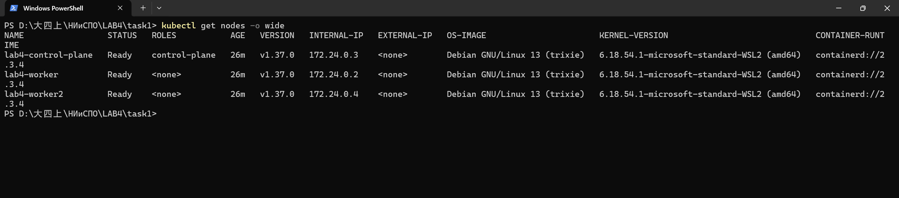
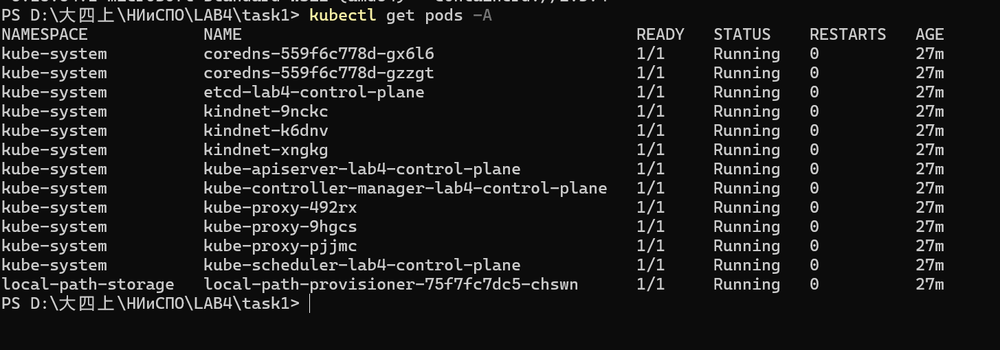
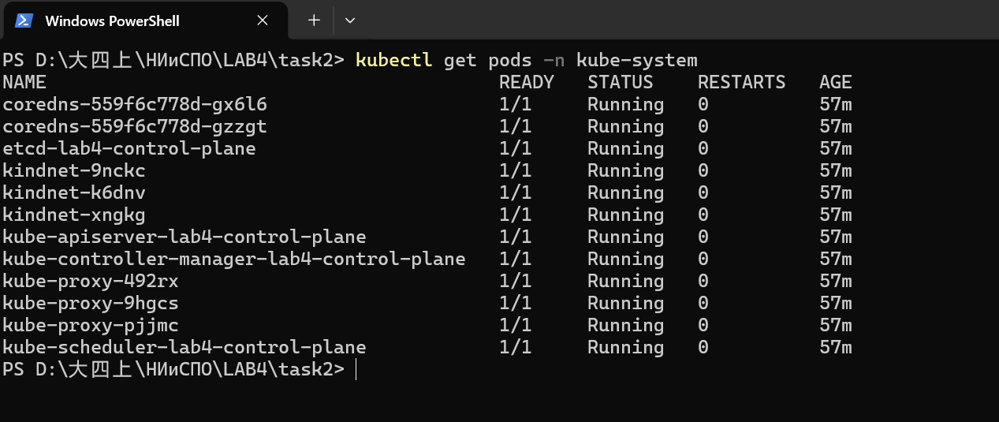
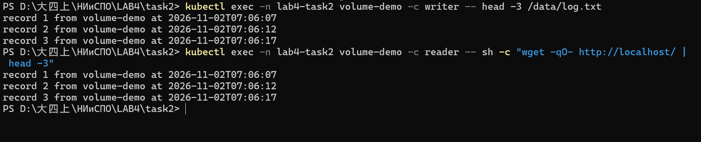
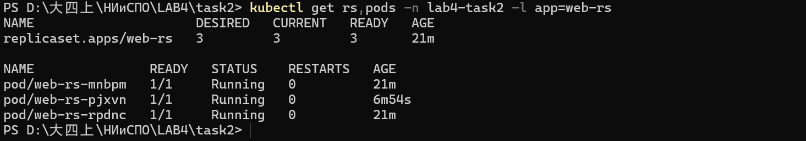

# Отчёт по лабораторной работе №4

**Дисциплина:** «Непрерывное интегрирование и сборка программного обеспечения»
**Тема:** Методы и средства оркестрации в многоконтейнерных системах

| | |
|---|---|
| **Выполнил** | Цзэн Яосинь (ZENG YAOXIN) |
| **Группа** | 13, ФПМИ БГУ |
| **Вариант задания** | группа 13 — задания 1 и 2 (задание 3 не выполняется) |
| **Репозиторий** | `task1/` — задание 1, `task2/` — задание 2, `docs/` — этот отчёт |

---

## 1. Цель работы

Изучить создание кластера Kubernetes и работу с его ресурсами: настроить локальное
окружение, развернуть кластер, освоить базовые объекты (поды, тома, ReplicaSet)
и научиться демонстрировать их работу.

Задачи работы:

1. Настроить окружение Kubernetes.
2. Выполнить задания варианта.

## 2. Вариант задания

Согласно критериям оценивания методических указаний: **для групп 10–12 — все три задания,
для группы 13 — задания 1–2**. Студент группы 13, поэтому выполнены:

* **Задание 1** — подготовка окружения для локального кластера;
* **Задание 2** — знакомство с ресурсами Kubernetes (пп. 5–7).

Задание 3 (развёртывание приложения через Deployment) не выполняется.

## 3. Задание 1. Подготовка окружения для локального кластера

### 3.1. Окружение

| Компонент | Версия | Примечание |
|-----------|--------|------------|
| ОС | Windows 11 + WSL2 | в методичке рекомендуется Ubuntu в виртуальной машине |
| Docker | 29.8.1 (linux/amd64) | Docker Desktop, обязателен для `kind` |
| kind | v0.33.0 | Kubernetes IN Docker |
| kubectl | v1.36.1 | клиент |
| Kubernetes | v1.37.0 | образ `kindest/node:v1.37.0`, containerd 2.3.4 |

### 3.2. Установка утилит (п. 5 задания)

```powershell
# kind для Windows x86-64; каталог %USERPROFILE%\bin добавлен в PATH
curl.exe -L -o "$env:USERPROFILE\bin\kind.exe" https://kind.sigs.k8s.io/dl/v0.33.0/kind-windows-amd64
kind version          # kind v0.33.0 go1.26.7 windows/amd64
kubectl version       # Client Version: v1.36.1
```

Для Ubuntu те же действия: `curl -Lo ./kind .../kind-linux-amd64 && chmod +x kind && sudo mv kind /usr/local/bin/`.

### 3.3. Конфигурация кластера

Файл [`task1/kind-config.yaml`](../task1/kind-config.yaml):

```yaml
kind: Cluster
apiVersion: kind.x-k8s.io/v1alpha4
name: lab4

nodes:
  - role: control-plane
    labels:
      tier: control-plane
  - role: worker
    labels:
      tier: worker
  - role: worker
    labels:
      tier: worker

networking:
  ipFamily: ipv4
  podSubnet: "10.244.0.0/16"
  serviceSubnet: "10.96.0.0/16"
```

Каждое поле: `name` задаёт имя кластера, docker-сети и контекст `kind-lab4`; `nodes` —
три узла, каждый реализован отдельным контейнером с `kubelet` и containerd; `podSubnet` /
`serviceSubnet` — диапазоны адресов подов и сервисов; `labels` — метки узлов для
`nodeSelector` в следующих заданиях.

### 3.4. Создание кластера (п. 6 задания)

```powershell
cd task1
kind create cluster --config kind-config.yaml
```

```
Creating cluster "lab4" ...
 ✓ Ensuring node image (kindest/node:v1.37.0) 🖼️
 ✓ Preparing nodes 📦 📦 📦
 ✓ Writing configuration 📜
 ✓ Starting control-plane 🕹️
 ✓ Installing CNI 🔌
 ✓ Installing StorageClass 💾
 ✓ Joining worker nodes 🚜
Set kubectl context to "kind-lab4"
```

### 3.5. Демонстрация работающего кластера (п. 7 задания)

```
$ kubectl get nodes -o wide
NAME                 STATUS   ROLES           AGE   VERSION   INTERNAL-IP   CONTAINER-RUNTIME
lab4-control-plane   Ready    control-plane   18m   v1.37.0   172.24.0.3    containerd://2.3.4
lab4-worker          Ready    <none>          18m   v1.37.0   172.24.0.2    containerd://2.3.4
lab4-worker2         Ready    <none>          18m   v1.37.0   172.24.0.4    containerd://2.3.4

$ kubectl cluster-info
Kubernetes control plane is running at https://127.0.0.1:59567
CoreDNS is running at https://127.0.0.1:59567/api/v1/namespaces/kube-system/services/kube-dns:dns/proxy

$ kind get clusters
lab4
```



*Рис. 1. `kubectl get nodes -o wide`: три узла в состоянии `Ready`, Kubernetes v1.37.0.*



*Рис. 2. `kubectl get pods -A`: 13 подов в состоянии `Running` (12 в `kube-system`
и `local-path-provisioner` в `local-path-storage`), перезапусков нет.*

Кластер работоспособен: все узлы `Ready`, все системные поды `Running`, `kubectl`
успешно обращается к API-серверу. Артефакты демонстрации — в [`task1/evidence/`](../task1/evidence/).

## 4. Задание 2. Знакомство с ресурсами Kubernetes

Все объекты в Kubernetes — ресурсы. Их список с псевдонимами выдаёт `kubectl api-resources`
(в кластере зарегистрирован 71 тип), а состояние — `kubectl get`.

### 4.1. Пространства имён

```
$ kubectl api-resources --api-group=apps
NAME                  SHORTNAMES   APIVERSION   NAMESPACED   KIND
daemonsets            ds           apps/v1      true         DaemonSet
deployments           deploy       apps/v1      true         Deployment
replicasets           rs           apps/v1      true         ReplicaSet
statefulsets          sts          apps/v1      true         StatefulSet

$ kubectl get ns
NAME                 STATUS   AGE
default              Active   47m
kube-node-lease      Active   47m
kube-public          Active   47m
kube-system          Active   47m
lab4-task2           Active   3m
local-path-storage   Active   46m
```

Для демонстрации создано отдельное пространство имён `lab4-task2`
([`task2/manifests/00-namespace.yaml`](../task2/manifests/00-namespace.yaml)):

```yaml
apiVersion: v1
kind: Namespace
metadata:
  name: lab4-task2
  labels:
    lab: "4"
    group: "13"
```

### 4.2. Системные поды и их назначение (п. 5 задания)

```
$ kubectl get pods -n kube-system
NAME                                         READY   STATUS    RESTARTS   AGE
coredns-559f6c778d-gx6l6                     1/1     Running   0          52m
coredns-559f6c778d-gzzgt                     1/1     Running   0          52m
etcd-lab4-control-plane                      1/1     Running   0          52m
kindnet-9nckc                                1/1     Running   0          51m
kindnet-k6dnv                                1/1     Running   0          51m
kindnet-xngkg                                1/1     Running   0          52m
kube-apiserver-lab4-control-plane            1/1     Running   0          52m
kube-controller-manager-lab4-control-plane   1/1     Running   0          52m
kube-proxy-492rx                             1/1     Running   0          51m
kube-proxy-9hgcs                             1/1     Running   0          52m
kube-proxy-pjjmc                             1/1     Running   0          51m
kube-scheduler-lab4-control-plane            1/1     Running   0          52m
```

| Компонент | Зачем нужен | Экземпляров |
|-----------|-------------|-------------|
| `kube-apiserver` | Единственная точка входа в кластер: принимает запросы `kubectl` и других компонентов, проверяет права, валидирует объекты и сохраняет их в `etcd`. Сам ничего не запускает | 1 (control-plane) |
| `etcd` | Key-value хранилище — единственный источник истины о состоянии кластера. Потеря `etcd` означает потерю кластера | 1 (control-plane) |
| `kube-scheduler` | Выбирает узел для нового пода: учитывает свободные ресурсы, метки, taints/tolerations; записывает выбор в `spec.nodeName`. Контейнеры не запускает | 1 (control-plane) |
| `kube-controller-manager` | Набор контроллеров, приводящих фактическое состояние к желаемому: `deployment`, `replicaset`, `node`, `job`, `endpoint`. Именно он создаёт замену удалённому поду | 1 (control-plane) |
| `kube-proxy` | Реализует Service на узле: правила iptables/IPVS превращают трафик на ClusterIP в трафик к подам, обновляются при изменении Endpoints | 3 (DaemonSet) |
| `coredns` | DNS кластера: `web-rs.lab4-task2.svc.cluster.local` → IP сервиса; без него не работает service discovery | 2 (Deployment) |
| `kindnet` | CNI-плагин kind: выдаёт подам адреса из `10.244.0.0/16` и настраивает маршруты между узлами | 3 (DaemonSet) |
| `local-path-provisioner` | Динамически создаёт PersistentVolume для PVC в StorageClass `standard` (namespace `local-path-storage`) | 1 |



*Рис. 3. `kubectl get pods -n kube-system`: 12 подов `Running`; `kube-proxy` и `kindnet`
запущены по одному на каждом узле, потому что отвечают за сеть конкретных подов.*

### 4.3. Том и его монтирование в pod (п. 6 задания)

Создан pod из двух контейнеров, которые используют **один том `emptyDir`**, смонтированный
по разным путям: `writer` пишет в `/data`, `reader` (nginx) раздаёт тот же каталог как
корень сайта. Полный манифест — [`task2/manifests/01-pod-emptydir.yaml`](../task2/manifests/01-pod-emptydir.yaml):

```yaml
apiVersion: v1
kind: Pod
metadata:
  name: volume-demo
  namespace: lab4-task2
spec:
  containers:
    - name: writer
      image: python:3.12.1-alpine
      command: ["/bin/sh", "-c"]
      args:
        - |
          i=0
          while true; do
            i=$((i+1))
            echo "record $i from $HOSTNAME at $(date +%Y-%m-%dT%H:%M:%S)" >> /data/log.txt
            cp /data/log.txt /data/index.html
            sleep 5
          done
      volumeMounts:
        - name: shared-data
          mountPath: /data
    - name: reader
      image: nginx:alpine
      volumeMounts:
        - name: shared-data
          mountPath: /usr/share/nginx/html
          readOnly: true
  volumes:
    - name: shared-data
      emptyDir:
        sizeLimit: 64Mi
```

Проверка (листинги — [`task2/evidence/04-volume-emptydir.txt`](../task2/evidence/04-volume-emptydir.txt)):

```
$ kubectl describe pod volume-demo -n lab4-task2 | sed -n '/Volumes:/,/Events:/p'
Volumes:
  shared-data:
    Type:       EmptyDir (a temporary directory that shares a pod's lifetime)
    SizeLimit:  64Mi

$ kubectl exec volume-demo -c writer -- head -3 /data/log.txt
record 1 from volume-demo at 2026-11-02T07:06:07
record 2 from volume-demo at 2026-11-02T07:06:12
record 3 from volume-demo at 2026-11-02T07:06:17

$ kubectl exec volume-demo -c reader -- sh -c "wget -qO- http://localhost/ | head -3"
record 1 from volume-demo at 2026-11-02T07:06:07
record 2 from volume-demo at 2026-11-02T07:06:12
record 3 from volume-demo at 2026-11-02T07:06:17
```

Вывод в обоих контейнерах идентичен, причём второй получен по HTTP через nginx:
файл, записанный `writer`, виден в `reader` — том общий.



*Рис. 4. Обе команды выводят одни и те же строки `record 1…3`: том `emptyDir` смонтирован
в два контейнера.*

Дополнительно проверен **постоянный** том ([`02-pvc.yaml`](../task2/manifests/02-pvc.yaml),
[`03-pod-pvc.yaml`](../task2/manifests/03-pod-pvc.yaml)):

```yaml
apiVersion: v1
kind: PersistentVolumeClaim
metadata:
  name: data-pvc
  namespace: lab4-task2
spec:
  accessModes: [ReadWriteOnce]
  storageClassName: standard
  resources:
    requests:
      storage: 128Mi
```

```
$ kubectl get pvc -n lab4-task2
NAME       STATUS   VOLUME                                     CAPACITY   ACCESS MODES   STORAGECLASS
data-pvc   Bound    pvc-3382a6ff-7694-46d0-b34b-37d919f323c1   128Mi      RWO            standard

# записали файл, удалили pod, создали заново -> данные сохранились
$ kubectl exec pvc-demo -- cat /data/persist.txt
written by pod pvc-demo at 2026-11-02T07:20:05
```

PersistentVolume создан динамически provisioner'ом StorageClass `standard`
(`rancher.io/local-path`), отдельный PV вручную не описывался. Листинги — в
[`task2/evidence/05-pvc.txt`](../task2/evidence/05-pvc.txt) и
[`06-pvc-persistence.txt`](../task2/evidence/06-pvc-persistence.txt).

### 4.4. ReplicaSet и коллекция подов (п. 7 задания)

Манифест [`task2/manifests/04-replicaset.yaml`](../task2/manifests/04-replicaset.yaml):

```yaml
apiVersion: apps/v1
kind: ReplicaSet
metadata:
  name: web-rs
  namespace: lab4-task2
spec:
  replicas: 3
  selector:
    matchLabels:
      app: web-rs
  template:
    metadata:
      labels:
        app: web-rs
    spec:
      containers:
        - name: web
          image: nginx:alpine
          ports:
            - containerPort: 80
```

Самовосстановление — удалили один под, контроллер создал новый за ~9 секунд:

```
$ kubectl delete pod web-rs-2qwjz -n lab4-task2
pod "web-rs-2qwjz" deleted from lab4-task2 namespace

$ kubectl get pods -n lab4-task2 -l app=web-rs -o wide
web-rs-mnbpm   1/1   Running   0   14m   10.244.2.3   lab4-worker2
web-rs-pjxvn   1/1   Running   0   9s    10.244.1.8   lab4-worker     <-- новый под
web-rs-rpdnc   1/1   Running   0   14m   10.244.1.4   lab4-worker
```

Масштабирование:

```
$ kubectl scale rs web-rs --replicas=5 -n lab4-task2   # DESIRED 5, CURRENT 5, READY 5
$ kubectl scale rs web-rs --replicas=3 -n lab4-task2   # DESIRED 3, CURRENT 3, READY 3
```



*Рис. 5. `kubectl get rs,pods -n lab4-task2 -l app=web-rs`: 3/3/3, под `web-rs-pjxvn`
возрастом 6m54s создан автоматически взамен удалённого.*

Полные листинги — [`07-replicaset.txt`](../task2/evidence/07-replicaset.txt),
[`08-replicaset-scale.txt`](../task2/evidence/08-replicaset-scale.txt).

### 4.5. Особенность окружения: загрузка образов

В используемом окружении `kind load docker-image` и обычный pull не работают:

* Docker Desktop включён **containerd image store**, поэтому `kind load` падает
  с `ctr: content digest ...: not found` (в архиве нет блобов других платформ);
* узлы kind наследуют proxy-настройки хоста (`127.0.0.1:54031`), недоступные из контейнера,
  поэтому kubelet получает `ImagePullBackOff`.

Решение реализовано в [`task2/scripts/load-images.sh`](../task2/scripts/load-images.sh):
`docker save` → передача архива в контейнер узла → `ctr -n k8s.io images import --platform linux/amd64`.
После этого `imagePullPolicy: IfNotPresent` использует локальный образ, сеть не нужна.

## 5. Структура репозитория

```
LAB4/
├── README.md                  # ссылка на отчёт, инструкции запуска
├── task1/                     # задание 1
│   ├── kind-config.yaml
│   ├── scripts/               # create-cluster, collect-evidence, delete-cluster
│   ├── evidence/              # листинги команд (01…09)
│   └── screenshots/           # рис. 1–2
├── task2/                     # задание 2
│   ├── manifests/             # namespace, pod с томом, PVC, pod с PVC, ReplicaSet
│   ├── scripts/               # load-images, collect-evidence
│   ├── evidence/              # листинги команд (01…09)
│   └── screenshots/           # рис. 3–5
└── docs/
    └── report.md              # этот отчёт
```

---

## 6. Ответы на контрольные вопросы

### 1. Что такое Kubernetes и зачем он нужен в работе с контейнерами?

Kubernetes — платформа оркестрации контейнеров. Контейнер сам по себе лишь упаковка
приложения; в реальной системе нужно решать, где его запустить, как перезапустить при
падении, как раздать трафик на несколько копий, как обновить без простоя. Kubernetes
принимает **декларативное описание желаемого состояния** (YAML-манифесты) и непрерывно
приводит к нему реальное состояние. Он даёт: планирование на узлы, самовосстановление,
горизонтальное масштабирование, service discovery и балансировку, rolling update,
управление конфигурацией и секретами, абстракцию над инфраструктурой.

### 2. Отличие «запустить контейнеры вручную через Docker» от «управлять ими в Kubernetes»

| | `docker run` вручную | Kubernetes |
|---|---|---|
| Модель | императивная: «сделай сейчас» | декларативная: «хочу, чтобы было так» |
| Узлы | одна машина | кластер из многих узлов |
| Перезапуск | вручную (`--restart` лишь грубая политика) | контроллеры пересоздают поды автоматически |
| Масштабирование | запуск N контейнеров вручную | `replicas: N`, `kubectl scale` |
| Сеть | `-p` на конкретном хосте | Service: стабильный IP/DNS и балансировка |
| Обновление | остановить и поднять | rolling update без простоя |
| Конфигурация | `-e`, `-v` в командной строке | ConfigMap, Secret, PV/PVC |

### 3. 1–2 примера задач, где оркестрация экономит время

1. **Веб-сервис из 10 реплик.** Вручную: 10 × `docker run -p`, свой реверс-прокси,
   ручной перезапуск упавших. В Kubernetes: один Deployment с `replicas: 10`, Service
   сам балансирует трафик, упавший под заменяется автоматически.
2. **Плановые задачи.** Вместо cron + скриптов на сервере — `CronJob`: расписание,
   хранение истории запусков, логи и статус каждого запуска в `kubectl get jobs`.
3. **Обновление версии.** `kubectl set image` запускает rolling update: поды заменяются
   по одному, при ошибке — `kubectl rollout undo`.

### 4. Основные компоненты кластера и их ответственность

* `kube-apiserver` — REST-API, единственная точка входа; аутентификация, авторизация,
  валидация, запись объектов в `etcd`.
* `etcd` — распределённое key-value хранилище, единственный источник истины о состоянии.
* `kube-scheduler` — выбирает узел для пода с учётом ресурсов, меток, taints/tolerations.
* `kube-controller-manager` — контроллеры, приводящие факт к желаемому (Deployment,
  ReplicaSet, Node, Job, Endpoints).
* `kubelet` — агент на каждом узле: получает PodSpec и запускает/контролирует контейнеры
  через CRI, сообщает статус в apiserver.
* `kube-proxy` — правила iptables/IPVS для Service на узле.
* CNI-плагин (`kindnet` в нашем кластере) — сеть подов, выдача IP, маршруты между узлами.
* `coredns` — DNS-имена сервисов внутри кластера.
* (в облаке) `cloud-controller-manager` — интеграция с балансировщиками и дисками провайдера.

### 5. Создание пода через YAML: обязательные поля

Под создаётся командой `kubectl apply -f pod.yaml`. Обязательные поля:

* `apiVersion` — версия API (`v1` для Pod);
* `kind` — тип ресурса (`Pod`);
* `metadata` — метаданные; обязательно `metadata.name` (уникальное в namespace),
  опционально `labels`, `annotations`, `namespace`;
* `spec` — описание желаемого состояния; для пода обязателен `spec.containers`
  (минимум один контейнер с `name` и `image`).

### 6. YAML-файл пода (10–15 строк) и что будет при пропуске поля

```yaml
apiVersion: v1              # версия API: без неё apiserver не знает, как разбирать объект
kind: Pod                   # тип ресурса
metadata:
  name: hello-pod           # имя пода, уникальное в пространстве имён
  labels:
    app: hello              # метка: по ней поды находят Service и ReplicaSet
spec:
  containers:
    - name: web             # имя контейнера внутри пода
      image: nginx:alpine   # образ, который запустит kubelet
      ports:
        - containerPort: 80 # порт, который слушает контейнер
```

Ключевые поля: `apiVersion` + `kind` определяют, какой ресурс и каким API создаётся;
`metadata.name` — адрес объекта (`kubectl get pod hello-pod`); `spec.containers` —
что именно запускать; `labels` — связь с Service/ReplicaSet.

Если пропустить обязательное поле, объект **не будет создан**, `kubectl apply` вернёт
ошибку валидации от apiserver, например:

* без `apiVersion`: `error: apiVersion is missing`;
* без `kind`: `error: unable to decode ... Object 'Kind' is missing`;
* без `metadata.name`: `Pod "..." is invalid: metadata.name: Required value`;
* без `spec.containers`: `Pod "..." is invalid: spec.containers: Required value`.

Кластер не хранит «недоделанный» объект: валидация выполняется до записи в `etcd`.

### 7. Сервисы: зачем нужны, разница ClusterIP и Headless

Поды эфемерны: их IP меняются при пересоздании. **Service** даёт постоянный адрес
(ClusterIP + DNS-имя) и балансирует трафик по подам, отобранным по `selector` (через
Endpoints). Пример: `web-rs` из трёх подов доступен по одному имени, хотя поды меняются.

* **ClusterIP** (по умолчанию) — виртуальный IP внутри кластера; `kube-proxy` через
  iptables/IPVS перенаправляет соединение на один из подов. Клиент не знает, к какому
  именно — это и есть балансировка. Пример: `curl http://web-svc` из другого пода.
* **Headless** (`clusterIP: None`) — виртуального IP нет, DNS возвращает A-записи
  **всех** подов сервиса. Клиент сам выбирает адрес. Нужно, когда важна идентичность
  конкретного экземпляра: StatefulSet (БД, брокеры), кластеры типа Cassandra/Kafka,
  где узлы должны знать друг друга по стабильным DNS-именам `pod-0.svc`, `pod-1.svc`.

### 8. NodePort и LoadBalancer: как внешний пользователь попадает в под

**NodePort** — сервис открывает один и тот же порт (30000–32767) на **каждом** узле.
Путь запроса: клиент → `http://<IP-узла>:30080` → `kube-proxy` на этом узле по правилам
iptables выбирает под из Endpoints → трафик идёт на `podIP:targetPort` (при необходимости
через CNI на другой узел) → контейнер.

**LoadBalancer** — надстройка над NodePort: облачный контроллер создаёт внешний
балансировщик с собственным публичным IP (и обычно с health-check'ами).
Путь: клиент → публичный IP балансировщика → балансировщик распределяет соединения
по узлам на `nodePort` → `kube-proxy` → под. Плюс: реальный внешний IP, TLS, распределение
между узлами, отсечение нездоровых узлов.

### 9. Порты и ограничения NodePort

* `port` — порт самого Service (внутри кластера);
* `targetPort` — порт контейнера;
* `nodePort` — порт на узлах, по умолчанию из диапазона **30000–32767**
  (меняется флагом `--service-node-port-range` у apiserver).

Ограничения: диапазон невелик и порты «нестандартные» (нельзя просто взять 80/443);
порт открывается на всех узлах, что расширяет поверхность атаки и требует настройки
firewall; нет L7-маршрутизации, TLS-терминации и умной балансировки по здоровью;
клиент должен знать IP узла, а при смене узлов адрес меняется; несколько сервисов
на одном порту не разместить.

### 10. Когда достаточно NodePort, а когда нужен LoadBalancer

* **NodePort достаточно**: локальная разработка и учебный кластер (`kind`, `minikube`),
  доступ из внутренней сети по известному IP узла, временный стенд, доступ через
  SSH-туннель. Пример из этой работы: если бы понадобилось открыть `web-rs` наружу,
  хватило бы `type: NodePort`.
* **Нужен LoadBalancer**: production с публичным доступом, когда требуется стабильный
  внешний IP и 80/443, TLS-терминация, health-check'и и распределение между узлами,
  а также когда клиенты не должны знать IP конкретных узлов.

### 11. Ingress: какую проблему решает, пример манифеста

Проблема: каждый сервис типа LoadBalancer требует своего внешнего балансировщика и IP —
это дорого и неудобно. **Ingress** — правило L7-маршрутизации HTTP/HTTPS через **одну**
точку входа: по хосту и пути запрос направляется в нужный Service. Требует
Ingress-контроллера (nginx-ingress, Traefik и др.).

```yaml
apiVersion: networking.k8s.io/v1
kind: Ingress
metadata:
  name: shop-ingress
  namespace: lab4-task2
spec:
  rules:
    - host: shop.example.com
      http:
        paths:
          - path: /api
            pathType: Prefix
            backend:
              service:
                name: api-svc
                port:
                  number: 80
```

Запрос `http://shop.example.com/api/orders` попадёт в контроллер Ingress, тот по хосту
`shop.example.com` и префиксу `/api` выберет Service `api-svc`, а Service — один из
своих подов. Остальные пути того же хоста можно отдать другому сервису (`/` → `web-svc`).

### 12. Deployment, StatefulSet, DaemonSet

| Критерий | Deployment | StatefulSet | DaemonSet |
|----------|------------|-------------|-----------|
| Цель | stateless-приложения: веб, API | stateful-приложения: БД, брокеры | агенты на **каждом** узле: логи, мониторинг, CNI |
| Порядок создания | параллельно, поды взаимозаменяемы | упорядоченно (`-0`, `-1`, …), каждый со своим именем и PVC | по одному на узел, порядок не важен |
| Привязка | к узлам не привязан, планируется свободно | к своему PVC и стабильному DNS-имени | жёстко к узлу (по одному поду на узел) |

Примеры и масштабирование до 3 реплик:

* **Deployment** (веб-приложение) — 3 одинаковых пода за Service, трафик делится между ними;
* **StatefulSet** (PostgreSQL) — появятся `db-0`, `db-1`, `db-2`, каждый со своим томом
  и DNS-именем; реплики не взаимозаменяемы, обычно одна primary и реплики;
* **DaemonSet** (агент логирования) — «3 реплики» не задаются: под запускается на каждом
  узле, поэтому при 3 узлах будет 3 пода, при добавлении узла — 4.

### 13. Job и CronJob

* **Job** — задача, выполняемая до успешного завершения (один или N раз).
  Пример: миграция схемы БД при релизе, разовый импорт данных.
* **CronJob** — Job по расписанию в формате cron. Пример: ночная выгрузка отчёта
  в 02:00, очистка старых файлов.

Проверка: `kubectl get jobs` (`COMPLETIONS 1/1`), `kubectl get pods` — под в статусе
`Completed`, `kubectl describe job <имя>` (условия `Complete`, время выполнения),
логи — `kubectl logs job/<имя>` или `kubectl logs <pod>`. Для CronJob:
`kubectl get cronjob` (`LAST SCHEDULE`, `ACTIVE`), история запусков —
`kubectl get jobs` (сколько хранить, задаёт `successfulJobsHistoryLimit`).

### 14. ConfigMap и Secret: зачем и два способа передачи в под

**ConfigMap** хранит несекретную конфигурацию (параметры, файлы настроек),
**Secret** — чувствительные данные (пароли, токены, ключи, сертификаты).
Оба позволяют не «запекать» конфигурацию в образ.

Способы передачи:

1. **Переменные окружения**: `envFrom.configMapRef` / `secretRef` (все ключи) или
   `env[].valueFrom.configMapKeyRef` / `secretKeyRef` (один ключ).
2. **Монтирование в том**: `volumes[].configMap` / `volumes[].secret` + `volumeMounts` —
   каждый ключ становится файлом в каталоге.

Когда что: переменные окружения удобны для небольших значений, читаемых один раз при
старте; том — для файлов конфигурации (nginx.conf, application.yml), сертификатов,
и когда нужно обновлять содержимое без пересоздания пода (kubelet обновляет
смонтированные файлы).

### 15. YAML для ConfigMap и Secret; почему пароли не хранят в ConfigMap

```yaml
apiVersion: v1
kind: ConfigMap
metadata:
  name: app-config
data:
  APP_MODE: production
  LOG_LEVEL: info
```

```yaml
apiVersion: v1
kind: Secret
metadata:
  name: db-secret
type: Opaque
data:
  DB_PASSWORD: c3VwZXItc2VjcmV0   # base64 от "super-secret"
```

Почему пароль не в ConfigMap:

* ConfigMap хранит данные **открытым текстом** — любой, у кого есть `get configmaps`
  (или доступ к etcd/манифесту в Git), увидит пароль;
* у ConfigMap нет отдельного механизма шифрования при хранении и ограничения прав,
  а Secret можно шифровать в `etcd` (`EncryptionConfiguration`) и закрывать RBAC отдельно;
* ConfigMap часто попадает в `describe`, логи и системы конфигурации — утечка почти
  неизбежна.

Важно: `base64` в Secret — **не шифрование**, а лишь кодирование; защиту дают RBAC,
шифрование at rest и недопущение попадания манифестов с секретами в Git.

### 16. 8–10 основных команд kubectl по группам

**Посмотреть состояние**

```bash
kubectl get pods -A -o wide        # список подов во всех namespace с узлами и IP
kubectl describe pod <pod>         # подробности: события, причины ошибок
kubectl logs <pod> [-c <контейнер>] [-f]   # логи контейнера
```

**Создать / обновить**

```bash
kubectl apply -f manifest.yaml     # создать или обновить из файла
kubectl create namespace <ns>      # быстрые императивные команды
kubectl scale rs web-rs --replicas=5
kubectl set image deployment/app web=nginx:1.28
```

**Удалить**

```bash
kubectl delete pod <pod>
kubectl delete -f manifest.yaml
kubectl delete namespace <ns>      # удаляет всё содержимое namespace
```

**Отладить**

```bash
kubectl exec -it <pod> -- sh       # зайти внутрь контейнера
kubectl port-forward pod/<pod> 8080:80
kubectl get events --sort-by=.lastTimestamp
kubectl rollout status deployment/app
```

### 17. Пространства имён: зачем и примеры

Namespace — логическое разделение ресурсов внутри одного кластера: имена уникальны
только внутри namespace, а квотами, RBAC и сетевыми политиками можно ограничить
пользователей и команды рамками своего пространства.

Примеры: `dev` / `stage` / `prod` для изоляции окружений одного приложения;
отдельные namespace для команд или проектов в общем кластере; системные
(`kube-system`) отдельно от пользовательских приложений; временные стенды,
которые удаляются одной командой.

### 18. Создание namespace и работа только в нём

```bash
kubectl create namespace lab4-task2          # или kubectl apply -f 00-namespace.yaml
kubectl get pods -n lab4-task2               # разовая команда в namespace
kubectl config set-context --current --namespace=lab4-task2   # сделать текущим
kubectl config view --minify | grep namespace                 # проверить
```

После смены контекста `kubectl get pods` работает в `lab4-task2` без `-n`.
В манифесте namespace задаётся полем `metadata.namespace`.

### 19. Пробы: liveness, readiness, startup

* **livenessProbe** — «жив ли контейнер». При провале kubelet **перезапускает** контейнер.
  Лечит зависания (deadlock), когда процесс существует, но не отвечает.
* **readinessProbe** — «готов ли принимать трафик». При провале под **исключается из
  Endpoints** Service (трафик на него не идёт), но контейнер не перезапускается.
  Нужна на время прогрева и при временной перегрузке.
* **startupProbe** — «приложение вообще стартовало». Пока она не пройдена, liveness
  и readiness не проверяются — это спасает медленно стартующие приложения от
  бесконечных перезапусков.

```yaml
livenessProbe:
  httpGet: { path: /healthz, port: 8080 }
  periodSeconds: 10
readinessProbe:
  httpGet: { path: /ready, port: 8080 }
  initialDelaySeconds: 5
startupProbe:
  httpGet: { path: /healthz, port: 8080 }
  failureThreshold: 30
  periodSeconds: 2
```

### 20. PV, PVC и как выделяется хранилище

**PersistentVolume (PV)** — ресурс кластера, описывающий реальный том (диск, NFS, каталог
на узле). **PersistentVolumeClaim (PVC)** — запрос приложения на том нужного размера
и режима доступа. Приложение не знает, где физически лежат данные.

Процесс: приложение создаёт PVC (`storage: 128Mi`, `accessModes`) → контроллер ищет
подходящий PV либо, если задан `storageClassName`, **provisioner создаёт PV динамически**
(`local-path` в нашем кластере) → PVC переходит в `Bound` → pod монтирует том через
`volumes[].persistentVolumeClaim.claimName`. В этой работе: `data-pvc` объёмом 128 MiB
получил PV `pvc-3382a6ff-…`, а данные пережили удаление пода.

### 21. Реакция Kubernetes на падение пода или узла

1. **Перезапуск контейнера**: `kubelet` следит за контейнерами и перезапускает их
   согласно `restartPolicy` (`Always` по умолчанию); `livenessProbe` ускоряет это
   при зависании.
2. **Пересоздание пода контроллером**: ReplicaSet/Deployment/StatefulSet сравнивают
   фактическое число подов с `replicas` и создают замену. В работе удаление
   `web-rs-2qwjz` привело к появлению `web-rs-pjxvn` за ~9 секунд.
3. **Реакция на падение узла**: `kube-controller-manager` помечает узел `NotReady`
   (heartbeat от `kubelet` пропал), поды на нём получают taint
   `node.kubernetes.io/unreachable` и через ~5 минут вытесняются; контроллер создаёт
   их заново на живых узлах. `DaemonSet` при этом автоматически добавит под на новый
   узел, если тот появится.

### 22. Обновление без простоя: rolling update и его параметры

`Deployment` со стратегией `RollingUpdate` заменяет поды постепенно: создаёт новые,
дожидается их готовности и только затем удаляет старые, поэтому сервис всё время
обслуживается.

```yaml
spec:
  strategy:
    type: RollingUpdate
    rollingUpdate:
      maxSurge: 1            # сколько подов можно создать сверх replicas
      maxUnavailable: 0      # сколько подов допустимо вывести из строя
  minReadySeconds: 5         # сколько под должен быть готов до продолжения
  progressDeadlineSeconds: 600  # сколько ждать прогресса, прежде чем считать релиз неудачным
  revisionHistoryLimit: 5    # сколько старых ReplicaSet хранить для отката
```

`maxSurge`/`maxUnavailable` задают «скорость» и запас по ёмкости: `maxUnavailable: 0`
+ `maxSurge: 1` — самый безопасный вариант без потери доступности.

### 23. Как запустить обновление и следить за прогрессом

```bash
kubectl set image deployment/web web=nginx:1.28    # или kubectl apply -f с новым образом

kubectl rollout status deployment/web              # ждать и видеть прогресс
kubectl get rs -l app=web                          # новый ReplicaSet растёт, старый уменьшается
kubectl get pods -l app=web -o wide                # поды с новым возрастом
kubectl rollout history deployment/web             # список ревизий
kubectl rollout undo deployment/web                # откат к предыдущей версии
```

`rollout status` выводит `Waiting for deployment "web" rollout to finish: 1 out of 3 new
replicas have been updated...` и завершается сообщением `deployment "web" successfully
rolled out`. Если поды не становятся готовыми дольше `progressDeadlineSeconds`, статус
покажет `ProgressDeadlineExceeded` — тогда смотрят `kubectl describe pod` и логи.

---

## 7. Выводы

В ходе работы развёрнут локальный кластер Kubernetes (kind v0.33.0, Kubernetes v1.37.0,
1 control-plane + 2 worker) и подтверждена его работоспособность: все узлы `Ready`,
все системные поды `Running`, `kubectl` работает с API-сервером.

Изучены базовые ресурсы: пространства имён и `api-resources`, назначение компонентов
`kube-system`. Продемонстрировано монтирование тома в под — `emptyDir`, общий для двух
контейнеров (данные `writer` читаются в `reader` и отдаются по HTTP), а также
`PersistentVolumeClaim` с динамическим PV, данные которого переживают удаление пода.
ReplicaSet показал самовосстановление (замена пода за ~9 с) и масштабирование 3 → 5 → 3.

Отдельно отмечена особенность окружения: из-за containerd image store в Docker Desktop
и недоступного из контейнеров proxy стандартные `kind load` и pull не работают,
поэтому образы загружаются скриптом через `docker save` + `ctr images import`.

## Приложение. Соответствие пунктов заданий и артефактов

| Пункт | Артефакт |
|-------|----------|
| Задание 1, п. 5 | `task1/scripts/create-cluster.ps1`, `task1/README.md` §2 |
| Задание 1, п. 6 | `task1/kind-config.yaml`, вывод `kind create cluster` |
| Задание 1, п. 7 | `task1/evidence/01…09`, рис. 1–2 |
| Задание 2, п. 5 | `task2/evidence/02-kube-system-pods.txt`, `03-kube-system-images.txt`, рис. 3 |
| Задание 2, п. 6 | `task2/manifests/01-pod-emptydir.yaml`, `02-pvc.yaml`, `03-pod-pvc.yaml`, `evidence/04…06`, рис. 4 |
| Задание 2, п. 7 | `task2/manifests/04-replicaset.yaml`, `evidence/07…08`, рис. 5 |
| Тесты / демонстрации | `task1/evidence/`, `task2/evidence/`, скриншоты в `task*/screenshots/` |

## Author

Цзэн Яосинь (ZENG YAOXIN), студент группы 13, ФПМИ БГУ.
