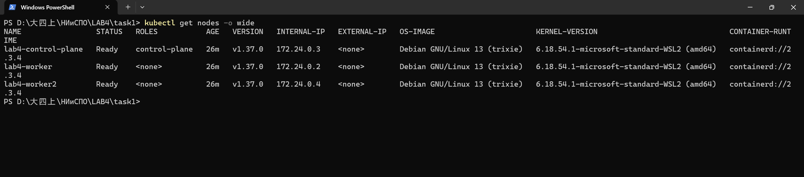
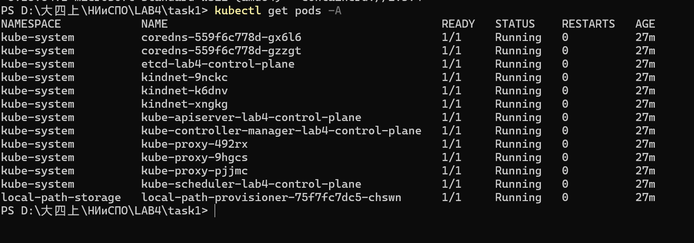

# Лабораторная работа №4 — Методы и средства оркестрации в многоконтейнерных системах

## Задание 1. Подготовка окружения для локального кластера

Группа 13 (по критериям оценивания группа 13 выполняет задания 1–2).
Цель задания — установить утилиты `kubectl` и `kind`, создать локальный кластер Kubernetes
и продемонстрировать его работоспособность.

Отчёт по всей работе — [`../docs/report.md`](../docs/report.md).

## 1. Окружение

| Компонент | Версия | Примечание |
|-----------|--------|------------|
| ОС | Windows 11 (WSL2) | альтернатива по методичке — Ubuntu в виртуальной машине |
| Docker | 29.8.1 (linux/amd64) | Docker Desktop, обязателен для `kind` |
| kind | v0.33.0 | Kubernetes IN Docker |
| kubectl | v1.36.1 | клиент |
| Kubernetes (кластер) | v1.37.0 | образ `kindest/node:v1.37.0`, containerd 2.3.4 |

Кластер: **1 control-plane + 2 worker** (3 узла), сеть подов `10.244.0.0/16`,
сеть сервисов `10.96.0.0/16`, API-сервер на `https://127.0.0.1:59567`.

## 2. Установка утилит

```powershell
# kind (Windows, x86-64) — кладём в %USERPROFILE%\bin, каталог добавлен в PATH
curl.exe -L -o "$env:USERPROFILE\bin\kind.exe" https://kind.sigs.k8s.io/dl/v0.33.0/kind-windows-amd64

# kubectl обычно уже установлен вместе с Docker Desktop; проверка:
kubectl version --client
```

Для Ubuntu (как в методичке) те же шаги выглядят так:

```bash
curl -Lo ./kind https://kind.sigs.k8s.io/dl/v0.33.0/kind-linux-amd64
chmod +x ./kind && sudo mv ./kind /usr/local/bin/kind
```

## 3. Конфигурация кластера

Файл [`kind-config.yaml`](kind-config.yaml):

```yaml
kind: Cluster
apiVersion: kind.x-k8s.io/v1alpha4
name: lab4
nodes:
  - role: control-plane
    labels:
      tier: control-plane
  - role: worker
    labels:
      tier: worker
  - role: worker
    labels:
      tier: worker
networking:
  ipFamily: ipv4
  podSubnet: "10.244.0.0/16"
  serviceSubnet: "10.96.0.0/16"
```

Что задаёт файл:

* `name: lab4` — имя кластера и Docker-сети, контекст kubectl `kind-lab4`;
* `nodes` — три «узла», каждый реализован отдельным Docker-контейнером с `kubelet` и containerd;
* `podSubnet` / `serviceSubnet` — диапазоны адресов для подов и сервисов (не пересекаются
  с домашней сетью и сетью Docker);
* `labels` — произвольные метки узлов (пригодятся для `nodeSelector` в следующих заданиях).

## 4. Создание кластера

```powershell
cd task1
kind create cluster --config kind-config.yaml
```

Либо готовым скриптом: `powershell -ExecutionPolicy Bypass -File .\scripts\create-cluster.ps1`
(в Git Bash / Linux — `bash scripts/create-cluster.sh`).

Фактический вывод:

```
Creating cluster "lab4" ...
 • Ensuring node image (kindest/node:v1.37.0) 🖼️
 ✓ Ensuring node image (kindest/node:v1.37.0) 🖼️
 • Preparing nodes 📦 📦 📦   ...
 ✓ Preparing nodes 📦 📦 📦
 • Writing configuration 📜  ...
 ✓ Writing configuration 📜
 • Starting control-plane 🕹️  ...
 ✓ Starting control-plane 🕹️
 • Installing CNI 🔌  ...
 ✓ Installing CNI 🔌
 • Installing StorageClass 💾  ...
 ✓ Installing StorageClass 💾
 • Joining worker nodes 🚜  ...
 ✓ Joining worker nodes 🚜
Set kubectl context to "kind-lab4"
```

`kind` сам записывает kubeconfig в `%USERPROFILE%\.kube\config` и делает контекст
`kind-lab4` текущим.

## 5. Демонстрация работающего кластера

### 5.1. Узлы

```
$ kubectl get nodes -o wide
NAME                 STATUS   ROLES           AGE   VERSION   INTERNAL-IP   OS-IMAGE
lab4-control-plane   Ready    control-plane   8m    v1.37.0   172.24.0.3    Debian GNU/Linux 13 (trixie)
lab4-worker          Ready    <none>          8m    v1.37.0   172.24.0.2    Debian GNU/Linux 13 (trixie)
lab4-worker2         Ready    <none>          8m    v1.37.0   172.24.0.4    Debian GNU/Linux 13 (trixie)
```

Все три узла в состоянии `Ready` — кластер работоспособен.

Метки `tier`, заданные в `kind-config.yaml`, применились (см. `evidence/09-node-labels.txt`):

```
$ kubectl get nodes -L tier
NAME                 STATUS   ROLES           AGE   VERSION   TIER
lab4-control-plane   Ready    control-plane   18m   v1.37.0   control-plane
lab4-worker          Ready    <none>          18m   v1.37.0   worker
lab4-worker2         Ready    <none>          18m   v1.37.0   worker
```

### 5.2. Адрес control plane и служебные сервисы

```
$ kubectl cluster-info
Kubernetes control plane is running at https://127.0.0.1:59567
CoreDNS is running at https://127.0.0.1:59567/api/v1/namespaces/kube-system/services/kube-dns:dns/proxy
```

### 5.3. Пространства имён

```
$ kubectl get namespaces
NAME                 STATUS   AGE
default              Active   2m28s
kube-node-lease      Active   2m28s
kube-public          Active   2m28s
kube-system          Active   2m28s
local-path-storage   Active   2m18s
```

### 5.4. Системные поды

```
$ kubectl get pods -A
NAMESPACE            NAME                                         READY   STATUS
kube-system          coredns-559f6c778d-gx6l6                     1/1     Running
kube-system          coredns-559f6c778d-gzzgt                     1/1     Running
kube-system          etcd-lab4-control-plane                      1/1     Running
kube-system          kindnet-9nckc                                1/1     Running
kube-system          kindnet-k6dnv                                1/1     Running
kube-system          kindnet-xngkg                                1/1     Running
kube-system          kube-apiserver-lab4-control-plane            1/1     Running
kube-system          kube-controller-manager-lab4-control-plane   1/1     Running
kube-system          kube-proxy-492rx                             1/1     Running
kube-system          kube-proxy-9hgcs                             1/1     Running
kube-system          kube-proxy-pjjmc                             1/1     Running
kube-system          kube-scheduler-lab4-control-plane            1/1     Running
local-path-storage   local-path-provisioner-75f7fc7dc5-chswn      1/1     Running
```

Все 13 подов в состоянии `Running`; `kube-proxy` и `kindnet` присутствуют в трёх экземплярах —
по одному на каждый узел (это `DaemonSet`). Подробный разбор этих компонентов — в задании 2, п. 5.

### 5.5. Скрипт сбора доказательств

```powershell
powershell -ExecutionPolicy Bypass -File .\scripts\collect-evidence.ps1
```

Результат сохраняется в каталог [`evidence/`](evidence/) — эти файлы приложены к отчёту:

| Файл | Содержимое |
|------|------------|
| `01-versions.txt` | версии Docker, kind, kubectl (клиент и сервер) |
| `02-cluster-info.txt` | `kubectl cluster-info` |
| `03-nodes.txt` | список узлов с IP, версией, container runtime |
| `04-namespaces.txt` | пространства имён |
| `05-pods-all.txt` | все поды кластера во всех namespace |
| `06-kind-clusters.txt` | `kind get clusters` |
| `07-kubeconfig-context.txt` | контексты kubectl |
| `08-demo-summary.txt` | сводная демонстрация (узлы + поды + версии) |
| `09-node-labels.txt` | метки узлов (`tier`), заданные в `kind-config.yaml` |

## 6. Структура каталога

```
task1/
├── kind-config.yaml          # конфигурация кластера (3 узла)
├── README.md                 # этот файл
├── scripts/
│   ├── create-cluster.ps1    # создание кластера (PowerShell)
│   ├── create-cluster.sh     # создание кластера (bash)
│   ├── collect-evidence.ps1  # сбор доказательств (PowerShell)
│   ├── collect-evidence.sh   # сбор доказательств (bash)
│   └── delete-cluster.ps1    # удаление кластера
├── evidence/                 # листинги команд = доказательство работы кластера
└── screenshots/              # снимки экрана для отчёта
```

## 7. Скриншоты

Снимки сделаны в терминале (`Win + Shift + S`):



*Рис. 1. `kubectl get nodes -o wide`: три узла в состоянии `Ready`, Kubernetes v1.37.0,
container runtime containerd 2.3.4.*



*Рис. 2. `kubectl get pods -A`: 13 подов в состоянии `Running`, перезапусков нет;
видно, что `kube-proxy` и `kindnet` запущены по одному на каждом узле.*

Необязательно: `screenshots/kind-create-cluster.png` — вывод `kind create cluster --config kind-config.yaml`
(делается только при пересоздании кластера).

## 8. Удаление кластера

```powershell
powershell -ExecutionPolicy Bypass -File .\scripts\delete-cluster.ps1
# или
kind delete cluster --name lab4
```

Кластер можно пересоздать в любой момент: `kind create cluster --config kind-config.yaml`
(занимает около 2 минут).

## Author

Цзэн Яосинь (ZENG YAOXIN), студент группы 13, ФПМИ БГУ.
