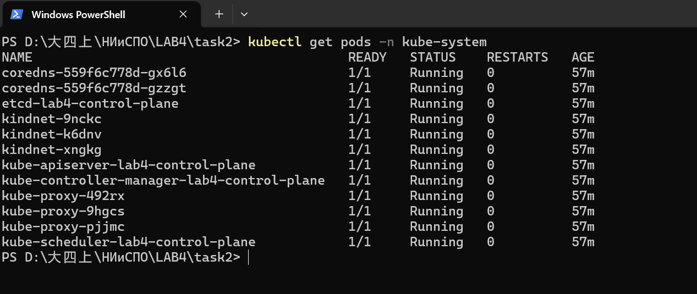
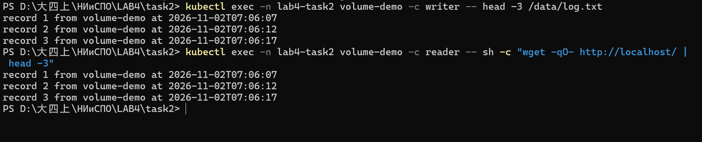
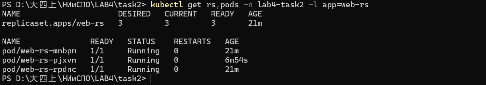

# Задание 2. Знакомство с ресурсами Kubernetes

Группа 13, ФПМИ БГУ. Кластер `lab4` из задания 1 (kind v0.33.0, Kubernetes v1.37.0,
1 control-plane + 2 worker).

Цель задания — научиться работать с базовыми ресурсами Kubernetes: пространствами имён,
подами, томами и ReplicaSet. Все объекты создаются в отдельном namespace `lab4-task2`,
чтобы демонстрацию можно было удалить одной командой.

Отчёт по всей работе — [`../docs/report.md`](../docs/report.md).

| Пункт задания | Что сделано | Где смотреть |
|---------------|-------------|--------------|
| 5 | разобраны поды `kube-system` и назначение каждого компонента | раздел 2, [`evidence/02`](evidence/02-kube-system-pods.txt) |
| 6 | создан том `emptyDir`, смонтированный в два контейнера одного пода; дополнительно — PVC с динамическим PV и проверкой сохранности данных | раздел 3, [`evidence/04`](evidence/04-volume-emptydir.txt), [`evidence/06`](evidence/06-pvc-persistence.txt) |
| 7 | создан ReplicaSet на 3 реплики: самовосстановление и масштабирование 3 → 5 → 3 | раздел 4, [`evidence/07`](evidence/07-replicaset.txt), [`evidence/08`](evidence/08-replicaset-scale.txt) |

## 1. Пространства имён и список ресурсов

`kubectl api-resources` показывает все типы объектов, которые знает API-сервер,
с их короткими именами (алиасами). В кластере зарегистрирован **71** тип ресурсов.

```
$ kubectl api-resources --api-group=apps
NAME                  SHORTNAMES   APIVERSION   NAMESPACED   KIND
controllerrevisions                apps/v1      true         ControllerRevision
daemonsets            ds           apps/v1      true         DaemonSet
deployments           deploy       apps/v1      true         Deployment
replicasets           rs           apps/v1      true         ReplicaSet
statefulsets          sts          apps/v1      true         StatefulSet
```

Отсюда, например, `kubectl get rs` — то же, что `kubectl get replicasets`.

Рабочее пространство имён создано манифестом [`manifests/00-namespace.yaml`](manifests/00-namespace.yaml):

```
$ kubectl get ns
NAME                 STATUS   AGE
default              Active   47m
kube-node-lease      Active   47m
kube-public          Active   47m
kube-system          Active   47m
lab4-task2           Active   3m
local-path-storage   Active   46m

$ kubectl get ns lab4-task2 --show-labels
NAME          STATUS   AGE   LABELS
lab4-task2    Active   3m    kubernetes.io/metadata.name=lab4-task2,group=13,lab=4
```

## 2. Системные поды `kube-system` и их назначение (п. 5 задания)

```
$ kubectl get pods -n kube-system
NAME                                         READY   STATUS    RESTARTS   AGE
coredns-559f6c778d-gx6l6                     1/1     Running   0          52m
coredns-559f6c778d-gzzgt                     1/1     Running   0          52m
etcd-lab4-control-plane                      1/1     Running   0          52m
kindnet-9nckc                                1/1     Running   0          51m
kindnet-k6dnv                                1/1     Running   0          51m
kindnet-xngkg                                1/1     Running   0          52m
kube-apiserver-lab4-control-plane            1/1     Running   0          52m
kube-controller-manager-lab4-control-plane   1/1     Running   0          52m
kube-proxy-492rx                             1/1     Running   0          51m
kube-proxy-9hgcs                             1/1     Running   0          52m
kube-proxy-pjjmc                             1/1     Running   0          51m
kube-scheduler-lab4-control-plane            1/1     Running   0          52m

$ kubectl get pods -n local-path-storage
NAME                                      READY   STATUS    RESTARTS   AGE
local-path-provisioner-75f7fc7dc5-chswn   1/1     Running   0          51m
```

В `kube-system` — **12** подов, все `Running`, перезапусков нет. Тринадцатый служебный
под (`local-path-provisioner`) живёт в отдельном пространстве имён `local-path-storage`.
Назначение каждого:

| Компонент | Роль | Особенность в кластере |
|-----------|------|------------------------|
| `kube-apiserver` | Единственная точка входа в кластер: принимает REST-запросы `kubectl` и компонентов, проверяет аутентификацию/авторизацию, валидирует объекты и пишет их в `etcd`. Ничего не «исполняет» сам — только хранит состояние | 1 экземпляр, только на control-plane |
| `etcd` | Распределённое key-value хранилище — **единственный источник истины** о состоянии кластера (все объекты, их версии, `resourceVersion`). Потеря `etcd` = потеря кластера | 1 экземпляр, локальный том на control-plane |
| `kube-scheduler` | Решает, **на каком узле** запустить новый pod: фильтрует узлы по ресурсам, меткам (`nodeSelector`, affinity), taints/tolerations и выбирает лучший по score. Сам pod не запускает — только проставляет `spec.nodeName` | 1 экземпляр на control-plane |
| `kube-controller-manager` | Набор контроллеров в одном процессе, которые приводят фактическое состояние к желаемому: `deployment`, `replicaset`, `node`, `job`, `endpoint` и др. Именно он создаёт замену удалённому поду ReplicaSet | 1 экземпляр на control-plane |
| `kube-proxy` | Реализует **Service** на уровне узла: создаёт iptables/IPVS-правила, чтобы трафик на ClusterIP/NodePort попадал в поды; обновляет правила при изменении Endpoints | `DaemonSet` — по одному на каждом из 3 узлов |
| `coredns` | Внутренний DNS кластера: имена вида `web-rs.lab4-task2.svc.cluster.local` → IP сервиса/пода. Без него не работает service discovery | Deployment, 2 реплики |
| `kindnet` | CNI-плагин kind: выдаёт подам IP из `10.244.0.0/16` и настраивает маршруты между узлами, чтобы поды на разных узлах видели друг друга | `DaemonSet`, 3 экземпляра |
| `local-path-provisioner` | Динамический provisioner StorageClass `standard`: по запросу PVC создаёт каталог на узле и PersistentVolume | в namespace `local-path-storage` |

Ключевая идея: **control-plane — это «мозг»** (`apiserver` + `etcd` + `scheduler` +
`controller-manager`), а `kube-proxy` и CNI работают на каждом узле, потому что отвечают
за сеть конкретных подов. Поэтому `kube-proxy` и `kindnet` присутствуют в трёх экземплярах.

Полный список с образами и узлами — [`evidence/03`](evidence/03-kube-system-images.txt).

## 3. Том и его монтирование в pod (п. 6 задания)

### 3.1. `emptyDir`, общий для двух контейнеров

Манифест [`manifests/01-pod-emptydir.yaml`](manifests/01-pod-emptydir.yaml): один pod,
два контейнера, один том.

```yaml
spec:
  containers:
    - name: writer                     # пишет строки в /data/log.txt
      image: python:3.12.1-alpine
      volumeMounts:
        - name: shared-data
          mountPath: /data
    - name: reader                     # nginx раздаёт тот же каталог
      image: nginx:alpine
      volumeMounts:
        - name: shared-data
          mountPath: /usr/share/nginx/html
          readOnly: true
  volumes:
    - name: shared-data
      emptyDir:
        sizeLimit: 64Mi
```

Том описан на уровне `spec.volumes`, а подключается к контейнерам через `volumeMounts`
(имя тома → путь внутри контейнера). Один и тот же `emptyDir` смонтирован по **разным**
путям, поэтому контейнеры видят одни и те же файлы.

Проверка, что том действительно общий:

```
$ kubectl describe pod volume-demo -n lab4-task2 | sed -n '/Volumes:/,/Events:/p'
Volumes:
  shared-data:
    Type:       EmptyDir (a temporary directory that shares a pod's lifetime)
    SizeLimit:  64Mi

$ kubectl exec volume-demo -c writer -- head -3 /data/log.txt
record 1 from volume-demo at 2026-11-02T07:06:07
record 2 from volume-demo at 2026-11-02T07:06:12
record 3 from volume-demo at 2026-11-02T07:06:17

$ kubectl exec volume-demo -c writer -- wc -l /data/log.txt
167 /data/log.txt

$ kubectl exec volume-demo -c reader -- ls -l /usr/share/nginx/html
-rw-r--r--    1 root     root          8409 Nov  2 07:19 index.html
-rw-r--r--    1 root     root          8409 Nov  2 07:19 log.txt

$ kubectl exec volume-demo -c reader -- wget -qO- http://localhost/ | head -3
record 1 from volume-demo at 2026-11-02T07:06:07
record 2 from volume-demo at 2026-11-02T07:06:12
record 3 from volume-demo at 2026-11-02T07:06:17
```

Файл, записанный контейнером `writer`, читается в `reader` и отдаётся nginx по HTTP —
том работает. Содержимое и размеры совпадают: в каталоге `reader` тот же `log.txt`
(8409 байт, столько же, сколько записал `writer`), а первые строки одинаковы.
Сравниваются именно **первые** строки, потому что `writer` дописывает по строке
каждые 5 секунд и конец файла постоянно меняется — начало же остаётся неизменным.

Важное свойство `emptyDir`: он живёт **столько же, сколько pod**. Удалили pod — данные
исчезли. Для данных, которые должны переживать пересоздание пода, нужен PVC.

### 3.2. PersistentVolumeClaim и динамический PersistentVolume

[`manifests/02-pvc.yaml`](manifests/02-pvc.yaml) запрашивает 128 MiB в StorageClass `standard`:

```yaml
spec:
  accessModes: [ReadWriteOnce]
  storageClassName: standard
  resources:
    requests:
      storage: 128Mi
```

Отдельный PV создавать не нужно — provisioner делает это сам:

```
$ kubectl get pvc -n lab4-task2
NAME       STATUS   VOLUME                                     CAPACITY   ACCESS MODES   STORAGECLASS
data-pvc   Bound    pvc-3382a6ff-7694-46d0-b34b-37d919f323c1   128Mi      RWO            standard

$ kubectl get pv
NAME                                       CAPACITY   ACCESS MODES   RECLAIM POLICY   STATUS   CLAIM
pvc-3382a6ff-7694-46d0-b34b-37d919f323c1   128Mi      RWO            Delete           Bound    lab4-task2/data-pvc
```

Проверка сохранности данных при пересоздании пода ([`evidence/06`](evidence/06-pvc-persistence.txt)):

```
# 1) пишем файл
$ kubectl exec pvc-demo -- sh -c 'echo "written by pod $HOSTNAME at $(date +%Y-%m-%dT%H:%M:%S)" > /data/persist.txt; cat /data/persist.txt'
written by pod pvc-demo at 2026-11-02T07:20:05

# 2) удаляем pod целиком
$ kubectl delete pod pvc-demo -n lab4-task2
pod "pvc-demo" deleted from lab4-task2 namespace

# 3) создаём заново из того же манифеста
$ kubectl apply -f manifests/03-pod-pvc.yaml
$ kubectl wait --for=condition=Ready pod/pvc-demo -n lab4-task2 --timeout=90s
pod/pvc-demo condition met

# 4) файл на месте
$ kubectl exec pvc-demo -- cat /data/persist.txt
written by pod pvc-demo at 2026-11-02T07:20:05
```

PVC остался в статусе `Bound` (тот же `VOLUME`), поэтому новый pod получил те же данные.
Обратите внимание: `df -h /data` внутри пода показывает ~1 ТБ — это файловая система узла;
`local-path` не ограничивает размер каталога квотой, 128 MiB — это заявка для планировщика,
а не жёсткий лимит. Для настоящего лимита нужен драйвер с поддержкой квот (например, CSI).

## 4. ReplicaSet: набор подов (п. 7 задания)

[`manifests/04-replicaset.yaml`](manifests/04-replicaset.yaml) — 3 реплики nginx,
селектор `app=web-rs`:

```yaml
spec:
  replicas: 3
  selector:
    matchLabels:
      app: web-rs
  template:
    metadata:
      labels:
        app: web-rs
    spec:
      containers:
        - name: web
          image: nginx:alpine
```

### 4.1. Самовосстановление

```
$ kubectl get rs -n lab4-task2 web-rs
NAME     DESIRED   CURRENT   READY   AGE
web-rs   3         3         3       3m22s

$ kubectl get pods -n lab4-task2 -l app=web-rs -o wide
web-rs-2qwjz   1/1   Running   0   11m   10.244.1.6   lab4-worker
web-rs-mnbpm   1/1   Running   0   14m   10.244.2.3   lab4-worker2
web-rs-rpdnc   1/1   Running   0   14m   10.244.1.4   lab4-worker

$ kubectl delete pod web-rs-2qwjz -n lab4-task2
pod "web-rs-2qwjz" deleted from lab4-task2 namespace

$ kubectl get pods -n lab4-task2 -l app=web-rs -o wide
web-rs-mnbpm   1/1   Running   0   14m   10.244.2.3   lab4-worker2
web-rs-pjxvn   1/1   Running   0   9s    10.244.1.8   lab4-worker     <-- новый pod
web-rs-rpdnc   1/1   Running   0   14m   10.244.1.4   lab4-worker
```

`kube-controller-manager` заметил расхождение (фактически 2 пода вместо 3) и создал
`web-rs-pjxvn` с новым именем и новым IP. Число подов восстановлено без вмешательства.

### 4.2. Масштабирование

```
$ kubectl scale rs web-rs --replicas=5 -n lab4-task2
replicaset.apps/web-rs scaled
$ kubectl get rs -n lab4-task2 web-rs
NAME     DESIRED   CURRENT   READY   AGE
web-rs   5         5         5       110s

$ kubectl scale rs web-rs --replicas=3 -n lab4-task2
replicaset.apps/web-rs scaled
$ kubectl get rs -n lab4-task2 web-rs
NAME     DESIRED   CURRENT   READY   AGE
web-rs   3         3         3       2m
```

При уменьшении ReplicaSet удаляет «лишние» поды сам, при увеличении — создаёт новые.
Имена подов всегда `<имя-rs>-<случайный суффикс>`, поэтому по имени pod нельзя
предсказать его порядковый номер (для этого нужен StatefulSet).

## 5. Структура каталога

```
task2/
├── manifests/
│   ├── 00-namespace.yaml        # namespace lab4-task2
│   ├── 01-pod-emptydir.yaml     # pod с томом emptyDir в двух контейнерах
│   ├── 02-pvc.yaml              # PersistentVolumeClaim 128Mi
│   ├── 03-pod-pvc.yaml          # pod, монтирующий PVC
│   └── 04-replicaset.yaml       # ReplicaSet, 3 реплики nginx
├── scripts/
│   ├── load-images.sh           # загрузка образов в узлы kind (см. примечание)
│   └── collect-evidence.sh     # сбор доказательств в evidence/
├── evidence/                    # листинги команд (01…09)
├── screenshots/                 # снимки экрана для отчёта
└── README.md
```

## 6. Как воспроизвести

```powershell
cd D:\大四上\НИиСПО\LAB4\task2

# один раз: загрузить образы в узлы кластера
bash scripts/load-images.sh

# создать все объекты задания
kubectl apply -f manifests/

# проверить
kubectl get all,pvc -n lab4-task2

# пересобрать доказательства
bash scripts/collect-evidence.sh

# удалить всё
kubectl delete namespace lab4-task2
```

### Примечание про образы

В этом окружении `kind load docker-image` и обычный `ImagePullBackOff` не работают:

* Docker Desktop использует **containerd image store**, из-за чего `kind load` падает
  с `ctr: content digest ...: not found` (в архиве нет блобов других платформ);
* узлы kind наследуют proxy-настройки хоста (`127.0.0.1:54031`), недоступные из контейнера,
  поэтому kubelet не может скачать образ из Docker Hub.

Поэтому [`scripts/load-images.sh`](scripts/load-images.sh) делает то же самое вручную:
`docker save` → поток в контейнер узла → `ctr -n k8s.io images import --platform linux/amd64`.
После этого `imagePullPolicy: IfNotPresent` берёт образ с узла, сеть не нужна.

## 7. Скриншоты

Снимки сделаны в терминале PowerShell (`Win + Shift + S`):



*Рис. 1. `kubectl get pods -n kube-system`: 12 подов в состоянии `Running`, перезапусков нет;
`kube-proxy` и `kindnet` — по три экземпляра (DaemonSet), остальные компоненты control plane —
по одному.*



*Рис. 2. Том `emptyDir` смонтирован в два контейнера: `writer` читает `/data/log.txt`,
`reader` отдаёт тот же файл через nginx по HTTP. Обе команды выводят одни и те же строки
`record 1…3` — том общий.*



*Рис. 3. `kubectl get rs,pods -n lab4-task2 -l app=web-rs`: `DESIRED/CURRENT/READY` = 3/3/3;
под `web-rs-pjxvn` с возрастом 6m54s создан автоматически после удаления предыдущего.*

Листинги тех же команд лежат в [`evidence/`](evidence/).

## Author

Цзэн Яосинь (ZENG YAOXIN), студент группы 13, ФПМИ БГУ.
